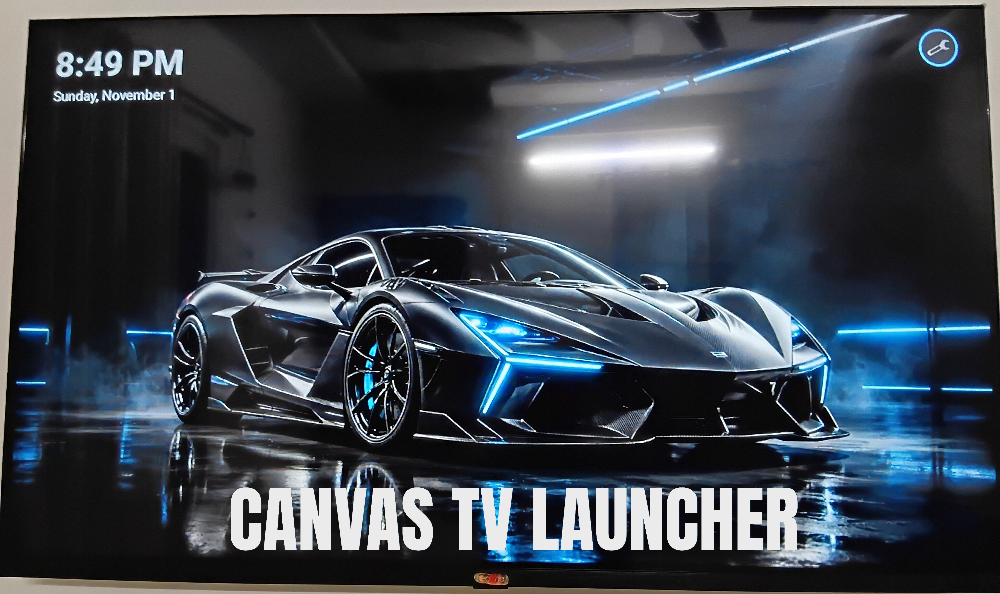
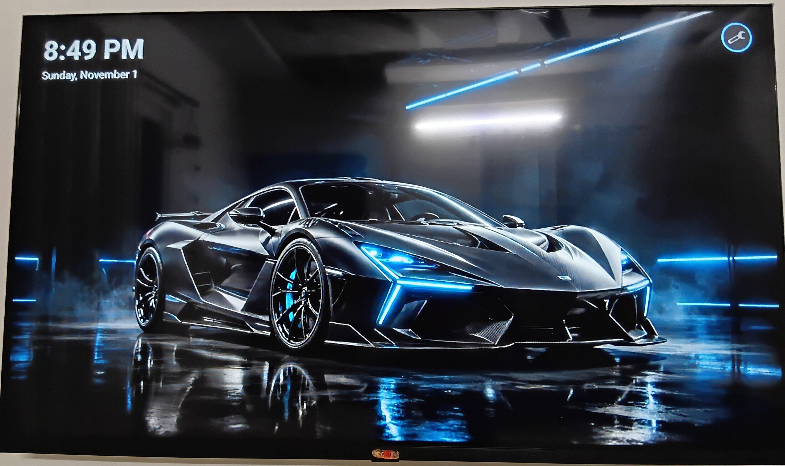
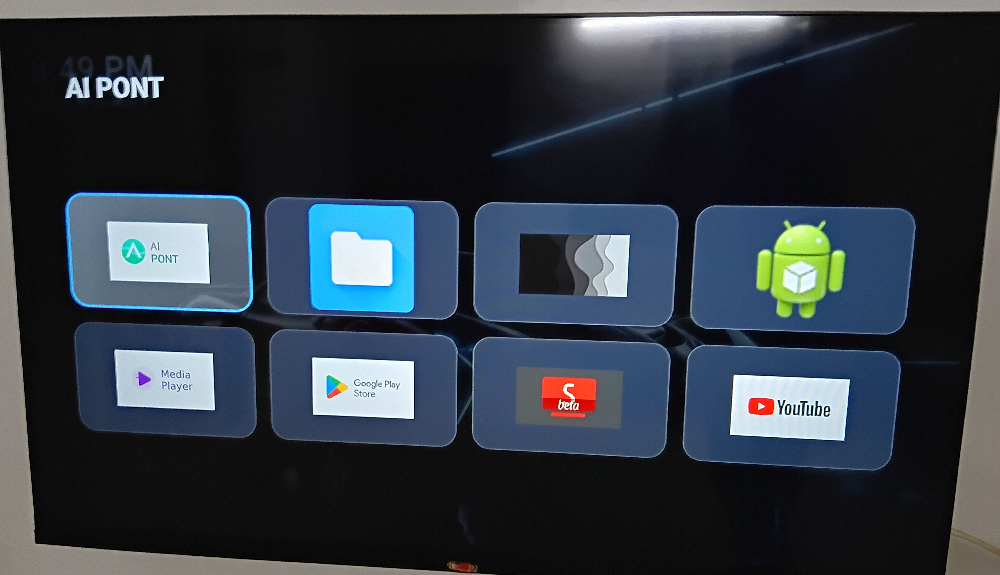
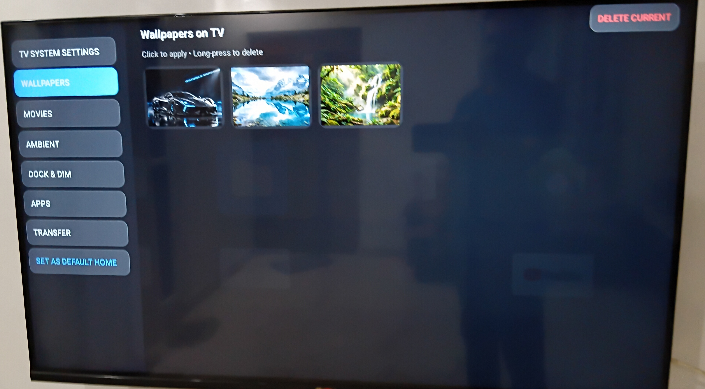

# Canvas TV Launcher

<p align="center">
  
</p>

<p align="center">
  <strong>A clean, ambient Android TV launcher that turns your TV into a personal canvas.</strong><br>
  Show your photos, videos, and memories instead of ads. Keep a tiny app dock. No bloat. No ads. No tracking.
</p>

<p align="center">
  
  
  
</p>

## Keywords
Android TV launcher, Google TV launcher, ambient canvas launcher, minimal TV launcher, wallpaper launcher, photo frame TV, ad-free launcher, lightweight launcher, D-pad TV launcher, phone to TV wallpaper transfer, custom home screen, TV wallpaper rotation

## Why Canvas TV Launcher?
Most TV launchers are built around apps, ads, and recommendations. Canvas TV Launcher is built around **your content**.

- **Ambient canvas**: your photos and memories become the home screen.
- **Tiny dock**: keep only the apps you actually use.
- **Phone-to-TV transfer**: scan a QR code and send wallpapers or videos from your phone.
- **No ads, no analytics, no tracking**.
- **Lightweight**: designed for low RAM and low CPU use.
- **Safe recovery**: stock launcher stays installed and recoverable.

## Features
- Ultra-minimal bottom app dock with configurable size (0–10 apps)
- Pin, hide, and reorder apps
- All Apps drawer via D-pad Down
- Wallpaper canvas with smooth crossfade transitions
- Automatic wallpaper rotation (Off, 15s, 30s, 1m, 1h)
- Adjustable dim scrim (bright or dimmed)
- Phone-to-TV wallpaper and video upload hub
- Movies shelf with VLC/Nova playback
- Ambient Keep Screen On option
- Safe-mode/recovery guidance in Settings
- Free-space check before uploads
- Original starter wallpapers included

## Screenshots

| Home Canvas | App Drawer | Settings Hub |
|---|---|---|
|  |  |  |

## Installation
### Option 1: GitHub Release (recommended)
1. Download the latest APK from the Releases page.
2. Install it on your Android TV / Google TV.
3. Open the app from your apps list.
4. Optionally set it as the default Home app.

### Option 2: ADB
```powershell
adb connect TV_IP:5555
adb install CanvasTVLauncher-debug.apk
adb shell am start -n com.canvas.tv.launcher.debug/com.canvas.tv.launcher.MainActivity
```

## Set as Default Launcher
1. Open Canvas TV Launcher.
2. Open Settings → System.
3. Tap **Set as Default Home**.
4. Or open TV System Settings → Apps → Default apps/Home app and select Canvas TV Launcher.

## Recovery / Safe Mode
If Canvas TV Launcher fails to start:
1. Open TV System Settings.
2. Go to Apps → Default apps (Home app).
3. Select your stock launcher.
4. Reboot if needed.

Keep the stock launcher installed. Do not disable it.

## How to Use
See [HELP.md](HELP.md) for step-by-step instructions.

## Privacy
Canvas TV Launcher does not collect analytics or personal data. Network access is used only for the optional local phone-to-TV transfer feature.

See [PRIVACY_POLICY.md](PRIVACY_POLICY.md).

## Known Limitations
- Rotation timing is best-effort; Android may defer work during sleep/idle.
- Very large images can increase memory use.
- Recovery from a broken default-launcher state requires TV Settings or ADB.
- Storage-full uploads are rejected, but existing files must be deleted to free space.

## Project Status
Beta. Built and tested on real Android TV devices. Feedback and contributions are welcome.

## Contributing
Contributions are welcome. Please keep the project aligned with its core promise:
- clean
- ambient
- low-resource
- no ads
- no tracking
- safe recovery

## License
MIT License. See [LICENSE](LICENSE).

## Credits
Inspired by the Android TV community and the need for a calmer, more personal TV home screen.
